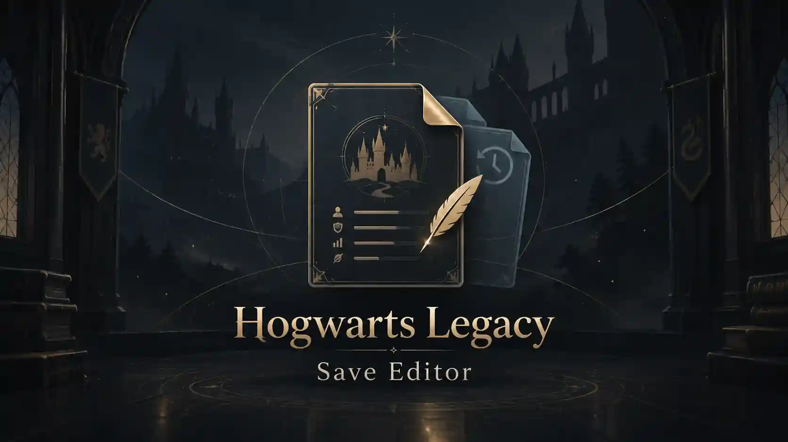

# Hogwarts Legacy Save Editor & Manager



A Windows desktop application for Hogwarts Legacy players who want to modify supported save-game data without manually extracting databases or switching between separate editing tools.

It combines save discovery, automatic backups, an integrated HLSGE-based editor, and `hlsaves` compression and decompression in a single workflow.

**[Download the latest release](../../releases/latest)** | [Release history](../../releases)

## Features

- **Save management:** Automatically find supported save folders or select one manually. Browse characters and save slots with useful in-game metadata.
- **Player and resource editing:** Modify supported values, including XP, Talent Points, Galleons and Wiggenweld Potions, with validation for progression-related changes.
- **Collections:** Edit supported Wand Handle and Revelio Page entries.
- **Gear stats:** Change stored Offense and Defense values for backpack equipment, with checks to prevent unintended changes to other items.
- **Automatic backups:** Preserve a copy of the selected save before editing and verify reconstructed saves before replacing the original.
- **Database export:** Export DB1 and DB2 as standalone SQLite files without modifying the original save.
- **Game Pass export:** Copy recognized Microsoft Store/Game Pass saves into ordinary folders for editing or migration.

The editor runs locally through PyWebView. Full-save edits are processed through the integrated conversion workflow rather than requiring manual database extraction and recompression.

## Installation

The packaged application requires **Windows**. Python and Node.js are only needed when running or building from source.

1. Download the latest ZIP from [GitHub Releases](../../releases/latest).
2. Extract the entire archive into a writable folder.
3. Run `HogwartsLegacy-SaveEditor.exe`.
4. Allow the application to locate the required Oodle library if prompted.

### Oodle requirement

The editor uses `oo2core_9_win64.dll` to process compressed saves. This proprietary library is **not included** in the repository or release packages.

The application first searches common Steam and Epic Games installation locations. If the DLL is not found, it offers a SHA-256-verified download from a third-party GitHub source or a broader search of local game folders. You can also select the file manually.

Using a compatible DLL from your own installed game is preferable. The optional third-party download is not an official Epic Games distribution channel.

## How to use

**Before editing, close Hogwarts Legacy and make an independent backup of your save files.**

1. Launch the application and select the detected save folder, or use **Browse** to choose one manually.
2. Select your character and save slot.
3. Click **Edit Save File** to open the integrated editor.
4. Make your changes, using **Apply** where the editor provides it.
5. Use the editor's **Download** action to save your changes.

For full-save downloads, the application rebuilds the `.sav` file and checks the reconstructed output before replacing the selected save.

Automatic backups are stored in the `Backups` folder inside the selected save directory. They can be restored manually if needed; the application does not provide automatic backup restoration.

DB1 and DB2 downloads behave differently: they export SQLite databases to a chosen destination without writing changes back to the `.sav` file.

### Microsoft Store / Game Pass saves

Game Pass saves use protected WGS storage and cannot be edited directly through this application.

To work with them:

1. Close the game.
2. Select **Export Game Pass Saves**.
3. Choose a destination outside the WGS directory.
4. Open the exported copies in the application's save browser.

**These are local editing or migration copies.** Changes are not synchronized back to WGS containers or Xbox cloud storage. Do not manually overwrite WGS files with edited copies.

See [Game Pass export documentation](docs/gamepass-safe-export.md).

## Limitations and safety

Save editing carries a risk of corrupted or incompatible progress. The application includes backups and file-integrity checks, but these cannot guarantee that every edited save will work in-game or protect against every interruption, concurrent modification or cloud synchronization conflict.

The following restrictions apply to the current release:

- **Character renaming is disabled.** First Name and Last Name are read-only because changing database values alone can leave the character-selection menu inconsistent. Custom database uploads are not a supported workaround.
- **Merlin Trial and Butterfly Chest completion is not implemented.** Their progression and reward behavior requires further validation.
- **Generic quest skipping is not supported.**
- **Gear editing is limited to stored backpack Offense and Defense values.** Gear levels, traits, appearance and equipped totals are not supported by this feature.
- **Older already-decompressed saves** are accepted only when their structure matches a validated layout. Compatibility with every historical save format is not guaranteed.

Version 1.0.7 includes corrections to Gear stat editing, native save conversion and compatibility with recognized older uncompressed saves. An actual in-game Gear edit passed loading, equipping, saving and restarting tests, but that result does not establish universal compatibility or resolve every reported Gear-related issue.

For the scope of testing and outstanding limitations, see the [release acceptance report](docs/release-candidate-acceptance.md) and [save integrity audit](docs/save-integrity-audit.md).

## Running from source

Requirements:

- Windows
- Python 3.12 or later
- Node.js 20 or later to rebuild the embedded editor
- A compatible Oodle DLL for save conversion

Clone the repository, install the verified converter and start the application:

```powershell
git clone https://github.com/falker47/HogwartsLegacy-SaveEditor.git
cd HogwartsLegacy-SaveEditor

powershell -NoProfile -ExecutionPolicy Bypass -File .\scripts\fetch_hlsaves.ps1
python -m pip install -r requirements.txt
python main.py
```

The converter installer uses a locally bundled, hash-verified `hlsavetool` archive. It does not download the converter or the Oodle DLL.

### Development and testing

The desktop manager uses Python, CustomTkinter and PyWebView. The embedded Vue/Vite editor source is maintained in `HLSE-src/`.

To run the Python tests:

```powershell
python -m pip install -r requirements-dev.txt
python -m pytest -q tests/
```

To test and rebuild the embedded editor:

```powershell
cd HLSE-src
npm ci
npm test
npm run build
```

On Windows, `build_release.bat` builds the distributable, including the embedded editor and verified converter, while excluding the proprietary Oodle DLL.

GitHub Actions runs Python tests, frontend tests and compilation, and a Windows release-build check. Some native Oodle validations require a locally available DLL and are not performed by public CI.

Converter patches, hashes and build provenance are documented in [third_party/hlsavetool/PROVENANCE.md](third_party/hlsavetool/PROVENANCE.md).

## Credits and licensing

This project integrates several independently developed components:

- **falker47** — Desktop manager, save discovery, backup workflow, editor integration and project maintenance.
- **Hawk-on** — Refactoring and improvements to the embedded editor integration.
- **Katt** — Original `hlsavetool` compression/decompression utility, available through [gx570s/hlsavetool](https://github.com/gx570s/hlsavetool) under the MIT license.
- **HLSGE** — The embedded editor is derived from [Hogwarts Legacy Save Game Editor](https://www.nexusmods.com/hogwartslegacy/mods/77), whose upstream permissions remain separate.
- **Epic Games / RAD Game Tools** — Oodle technology used by the required proprietary runtime library.

The [MIT License](LICENSE) applies to original code authored for this repository. It does not automatically cover the HLSGE-derived editor, proprietary Oodle components or other third-party material.

See [CREDITS.md](CREDITS.md) and [THIRD_PARTY_NOTICES.md](THIRD_PARTY_NOTICES.md) for full attribution, provenance and licensing boundaries.

## Disclaimer

This is an unofficial fan-made project, not affiliated with Avalanche Software, Warner Bros. Games, Epic Games or the original third-party tool authors.

Always keep independent backups before modifying your game progress.
